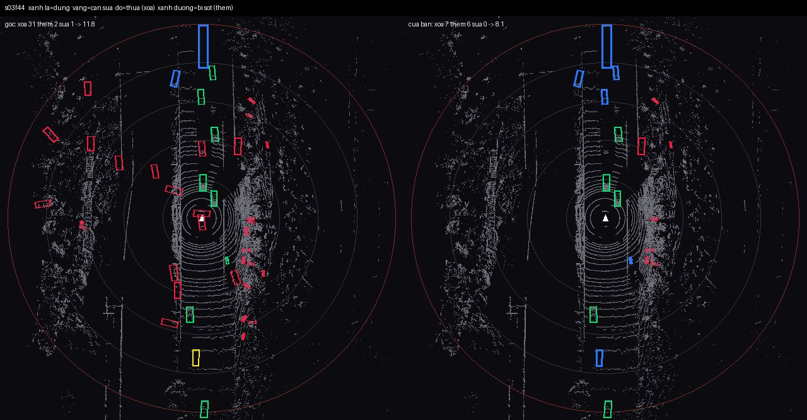

# Báo cáo Day 14 — Nguyễn Huy Vương — 2A202603133

> Sao chép file này thành `report/individual/<MSSV>_<HoTen>.md` (không dấu), ví dụ `2A20260000_NguyenVanAn.md`.

- Mã học viên dùng với `--student`: `133`
- `seed_tag` trong `frames_A.txt`: `393590736f`

## 1. Dự đoán trước sweep (bước 5b)

Ghi **trước** khi chạy `scripts/pp_sweep.py`, rồi commit và push ngay (lịch sử commit là bằng chứng thời điểm viết). Không sửa phần này sau khi có kết quả.

- Tham số tôi nghĩ giảm công sửa nhiều nhất: Tăng ngưỡng độ tin cậy `score_thr` từ mức mặc định `0.1` lên khoảng `0.3` – `0.4` (kết hợp lọc số điểm tối thiểu `min_points=5`).
- Vì sao (nhìn ảnh BEV tập A: box thừa nhiều hay box sót nhiều?): Nhìn trên ảnh BEV và 7 góc camera của 3 frame tập A (`s03f44`, `s04f17`, `s05f27`), số lượng box thừa (false positives) chiếm áp đảo so với số box bị sót: cấu hình gốc sinh ra tới 92 box nhưng thực tế chỉ có 49 vật thể thật (phải xóa tới 52 box thừa, thêm 9 box sót và sửa 5 box, tổng chi phí gốc 27.1; riêng `s03f44` có tới 31 box thừa do model nhận nhầm hàng cây/bụi rậm ven đường thành `Cyclist` và `Car` ở điểm tin cậy thấp `0.24–0.38`, cùng các box nhận nhầm chính thân xe ego hoặc hộp rỗng rất ít điểm). Vì phần lớn các box nhiễu này có `score < 0.4` hoặc ít điểm LiDAR, việc nâng `score_thr` lên `0.3–0.4` và `min_points=5` sẽ loại bỏ hàng loạt hộp thừa mà ít làm mất các xe thật gần có `score` cao (`> 0.5`), giúp giảm mạnh thành phần `0.3 * xóa` trong tổng chi phí sửa.

## 2. Tập A: sửa tay và tune

| Cấu hình | Xóa | Thêm | Sửa | Chi phí |
|---|---:|---:|---:|---:|
| Gốc | 52 | 9 | 5 | 27.1 |
| `best_config.json` | 12 | 13 | 4 | 18.6 |

- Tham số đã đổi trong `best_config.json`: `score_thr: 0.1 -> 0.5` (giữ `min_points: 0`; trong bảng `sweep.csv`, ba mức `min_points=0, 5, 10` tại `score_thr=0.5` đều đạt cùng chi phí thấp nhất là `18.60`).
- Kết quả leave-one-out (dán các dòng `scripts/pp_sweep.py` in ra):
  ```text
  Leave-one-out (chọn trên các frame còn lại, chấm trên frame bỏ ra):
    s03f44: cấu hình chọn {'score_thr': '0.5', 'min_points': '0'} → 8.1 (tốt nhất có thể 7.6)
    s04f17: cấu hình chọn {'score_thr': '0.5', 'min_points': '0'} → 5.6 (tốt nhất có thể 5.6)
    s05f27: cấu hình chọn {'score_thr': '0.4', 'min_points': '0'} → 7.6 (tốt nhất có thể 4.9)
  ```
- Cấu hình có ổn định trên từng frame không? Vì sao tôi vẫn chọn (hoặc không chọn) nó: Cấu hình nhìn chung khá ổn định ở vùng ngưỡng cao (`score_thr` từ `0.4` đến `0.5`), nhưng vẫn có sự dao động nhẹ giữa các frame do tập A chỉ có 3 frame: khi bỏ `s03f44` hoặc `s04f17`, thuật toán đều chọn `{'score_thr': '0.5', 'min_points': '0'}` và đạt chi phí rất sát hoặc bằng mức `oracle` (`8.1` so với `7.6` trên `s03f44`; `5.6` trùng khớp `5.6` trên `s04f17`). Tuy nhiên, khi bỏ `s05f27` ra, hai frame còn lại chọn `score_thr=0.4` làm chi phí trên `s05f27` là `7.6` (cao hơn mức `oracle` `4.9` tại `score_thr=0.5`, do `s05f27` có một cụm box thừa chồng lên xe con bên trái và ở vùng cây có `score` trong khoảng `0.41–0.45`). Tôi vẫn chọn `best_config.json` (`score_thr=0.5`, `min_points=0`) vì nó giảm mạnh số box thừa phải xóa từ `52` xuống `12` trên toàn tập A và cho tổng chi phí thấp nhất (`18.6` so với `27.1` của cấu hình gốc), dù đánh đổi bằng việc tăng nhẹ số box phải vẽ thêm từ `9` lên `13`.

## 3. Trước/sau (bước 8)



- `scripts/pp_compare.py` báo giảm **31%** công sửa trên tập A (tổng chi phí giảm từ `27.1` xuống `18.6`; cụ thể: `s03f44` giảm từ `11.8` xuống `8.1`, `s04f17` giảm từ `6.5` xuống `5.6`, `s05f27` giảm từ `8.8` xuống `4.9`).
- Dự đoán ở mục 1 đúng hay sai? Giải thích bằng số box xóa/thêm/sửa: Dự đoán ở mục 1 là **đúng về xu hướng và cơ chế tác động của `score_thr`, nhưng lệch nhẹ về mốc tối ưu** (tôi dự đoán `score_thr` khoảng `0.3–0.4` kèm `min_points=5`, còn thực tế `sweep.csv` đạt chi phí thấp nhất ở `score_thr=0.5`). Cụ thể theo số box:
  - Ở cấu hình gốc (`score_thr=0.1`), model sinh quá nhiều box nhiễu nên phải **xóa 52 box** (tốn `52 × 0.3 = 15.6` điểm chi phí), **thêm 9 box** (`9.0` điểm) và **sửa 5 box** (`2.5` điểm), tổng `27.1`.
  - Khi nâng lên `score_thr=0.3` và `0.4` (như dự đoán), số box cần xóa giảm xuống `41` (`chi phí 23.8`) rồi `26` (`chi phí 20.8`), trong khi số box bị sót cần thêm chỉ tăng nhẹ từ `9` lên `11`.
  - Khi nâng tiếp lên `score_thr=0.5` (`best_config.json`), số box thừa cần xóa giảm thêm `14` box (từ `26` xuống chỉ còn **12 box**, tiết kiệm thêm `14 × 0.3 = 4.2` điểm), trong khi số box thật bị lọc nhầm phải vẽ thêm chỉ tăng `2` box (từ `11` lên **13 box**, tăng `2 × 1.0 = 2.0` điểm) và số box cần sửa còn **4 box**. Nhờ lượng giảm của `0.3 · xóa` lớn hơn lượng tăng của `1.0 · thêm`, tổng chi phí đạt mức tối ưu `18.6` (giảm `31%`). Ngoài ra, ở ngưỡng `score_thr >= 0.4`, các box rỗng hoặc quá ít điểm đã bị loại theo `score`, nên `min_points=0, 5, 10` cho kết quả như nhau.

## 4. Tập B

Số đo từ `scripts/pp_prelabel.py --frames d14_133/frames_B.txt --config d14_133/best_config.json --gt d14_133/ref_B.json`:

| Xóa | Thêm | Sửa | Chi phí |
|---:|---:|---:|---:|
| 31 | 47 | 8 | 60.3 |

- Loại box tốn công sửa nhất ở tập B:
  1. **Các vật thể bị model bỏ sót phải vẽ thêm từ đầu (`Thêm = 47 box`, chiếm `47.0 / 60.3` chi phí):** Do `best_config.json` đặt `score_thr=0.5` khá cao để chặn hộp thừa, nhiều phương tiện ở xa (`25–45 m`), xe bị che khuất một phần ở làn đối diện hoặc người đi xe đạp/xe máy (`Cyclist`), người đi bộ (`Pedestrian`) có điểm tin cậy trong khoảng `0.20–0.49` bị lọc mất, buộc phải vẽ mới bằng `Shape` và căn chỉnh trên cả 3 mặt cắt `Top/Side/Front`.
  2. **Các phương tiện cỡ lớn (`Bus`, `Truck`) và xe hai bánh bị gán sai lớp hoặc lệch kích thước/độ cao đáy (`Sửa = 8 box` và một số `Bus` phải vẽ mới):** Model KITTI không có lớp `Bus`/`Truck` nên xe buýt lớn (như ở `s01f10`, `s02f00`, `s03f57`, `s04f31`) hoặc xe tải/van chở hàng (`s03f03`, `s04f04`) bị bỏ sót hoặc bị dự đoán thành hộp `Car` nhỏ hơn thực tế; ngoài ra một số `Cyclist` bị đoán nhầm thành `Car` (như ở `s04f47`) hoặc hộp ở xa bị lơ lửng/chìm so với mặt đường cần chỉnh lại `z`, `L/W/H` và nhãn.

## 5. Giới hạn

- Nêu ít nhất 2 giới hạn (ví dụ: chỉ 3 frame tune; model KITTI không có Truck/Bus; chi phí là công thức, chưa phải thời gian sửa thật):
  1. **Lệch miền dữ liệu (Domain Shift) giữa KITTI và VF LiDAR:** Mô hình PointPillars được huấn luyện trên KITTI (chỉ gán nhãn góc nhìn 90° phía trước và chỉ có 3 lớp `Car`, `Pedestrian`, `Cyclist`). Khi chạy 4 lượt xoay (`passes=4`) trên dữ liệu VF 360°, mô hình hoàn toàn không biết lớp `Truck` và `Bus` (dẫn tới bỏ sót xe buýt/xe tải hoặc đoán thành các hộp `Car` rời rạc), hay nhận nhầm dải cây xanh/hàng rào hai bên đường thành `Cyclist`/`Car` và nhận nhầm chính mui xe gắn cảm biến (ego-vehicle) ở gần tâm `(0, 0)`.
  2. **Kích thước tập tune (Tập A) rất nhỏ (chỉ 3 frame) và đánh đổi khi dùng một ngưỡng `score_thr` chung:** Việc chọn cấu hình trên 3 frame dễ bị thiên lệch theo đặc thù cảnh (ví dụ `s03f44` và `s05f27` có nhiều cây cối/hộp nhiễu nên đẩy `score_thr` tối ưu lên tới `0.5`). Khi mang `score_thr=0.5` sang 12 frame Tập B, dù giảm được rất nhiều hộp thừa (chỉ phải xóa 31 box trên 12 frame), ngưỡng cao này lại làm lọc mất nhiều `Car` ở xa và `Cyclist` có điểm tin cậy `0.25–0.48`, khiến số hộp phải vẽ thêm trên Tập B tăng lên (`47` box).
  3. **Hàm chi phí `0.3·xóa + 1.0·thêm + 0.5·sửa` chỉ là ước lượng tuyến tính đơn giản, chưa phản ánh đúng thời gian thao tác thật:** Công thức gán mọi thao tác "sửa" cùng trọng số `0.5` và chỉ xét sai số trong ngưỡng dung sai (`0.3 m` tâm, `0.2 m` kích thước, `10°` phương trục dài mod `180°`). Trong thực tế trên CVAT 3D, việc đổi nhãn lớp hoặc xoay đầu xe ngược `180°` (vốn không bị tính lỗi trong `needs_edit`) khác hẳn thời gian căn chỉnh lại cả 6 mặt hộp cho một chiếc `Bus`/`Truck`, và công thức cũng không tính các hộp nằm ngoài bán kính `50 m`.
